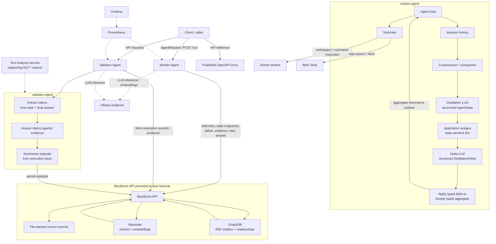

# Inference Backbone — Agent Guide

This file gives coding agents a working architectural map of the repository, identifies the main concepts and service boundaries, and records repository-specific development conventions.

It is an orientation document, not a substitute for reading the implementation. **When this document and the code disagree, the code is authoritative.** If you discover a material discrepancy, report it and propose a documentation correction rather than silently relying on the stale description.

## Project purpose

Inference Backbone is an experimental system for accumulating, retrieving, and validating knowledge produced by agent executions. Its central concern is not simply retaining conversation history: it is turning execution traces into structured information that can be persisted, retrieved, related to evidence, and used by later executions.

The system combines:
- LLM-driven worker execution and tool use.
- Compression and distillation of execution history into structured agent state.
- Typed state deltas that describe changes between a prior aggregate and a newly distilled state.
- Evidence and claim extraction/validation.
- File-backed persistence, vector retrieval, and graph projections.
- Supporting execution, web-access, and observability services.

The repository is an evolving research and engineering project. Avoid treating aspirational designs or roadmap ideas as implemented behavior.

## Architecture at a glance



The diagram is a logical view, not a complete network or deployment diagram. See `docker-compose.yml` for actual service networks, ports, volumes, and environment configuration.

### Main runtime paths

1. A caller submits an `AgentRequest` to `worker-agent` (`POST /run`).
2. The worker runs an LLM/tool loop and records iterations and tool results.
3. As context grows, the worker compresses history and distills portions of it into a structured `AgentState`.
4. The application stamps IDs onto the newly distilled state elements.
5. A separate delta-inference step compares the prior aggregate with the latest state and returns a typed `DistillationDelta`.
6. The worker persists the delta and applies it to the aggregate. The aggregate is then used when constructing later LLM context.
7. Worker telemetry sends execution records and artifacts to the Backbone API.
8. The validator can retrieve execution records and evidence, extract claims from the task/final answer, assess claims against evidence, and synthesize an `Episode`.
9. The Backbone API persists source records and projects selected information into Weaviate and GraphDB for retrieval and relationship queries.

These operations are related but are not one synchronous request chain. In particular, the worker can persist telemetry while the validator is invoked separately for a given `execution_id`.

## Services and boundaries

| Component | Responsibility | Important locations |
|---|---|---|
| Worker Agent | Runs the main agent loop, constructs toolchains, manages iterations, compresses/distills history, infers and applies state deltas, and emits telemetry. | `worker-agent/app/main.py`, `worker-agent/app/agent/` |
| Validator Agent | Extracts claims, assesses them against retrieved evidence, and creates episodes from execution traces or reports. | `validator-agent/app/main.py`, `validator-agent/app/agent/` |
| Backbone API | Accepts ingestion and retrieval requests; persists source artifacts and projects structured information to storage backends. | `backbone-api/main.py`, `backbone-api/routers/`, `backbone-api/clients/`, `backbone-api/projections/` |
| Contracts | Shared Pydantic models used across services. | `contracts/` |
| Docker Broker | Provides on-demand Docker-backed execution used by worker tools. | `docker-broker/` |
| Web Tools | Provides web search/fetch functionality on a separately configured network path. | `web-tools/` |
| Text Analysis | Provides supporting text/NLP and report-preparation functionality. | `text-analysis/` |
| Observability | Shared metric definitions and Prometheus/Grafana configuration. | `observability/`, `prometheus/`, `grafana/` |

Keep service boundaries intact. Prefer shared contracts for cross-service payloads; do not import another service's internal implementation modules to share a data shape.

## Key concepts

### Execution and worker context

- **`AgentRequest`** (`contracts/inference_contracts/worker_agent_request.py`): request configuration for a worker run, including the task, mode, model settings, context limits, and execution identity.
- **`execution_id`**: identifier used to associate a run's task, tool events/evidence, state snapshots, deltas, final answer, claims, and episode.
- **`Iteration`** (`worker-agent/app/agent/models.py`): in-memory record of a worker iteration, including model response and tool-call results.
- **`ToolCallResultWrapper`**: retains raw tool output, compressed output, selected chunks, utility/query information, and fingerprints used by the worker's context-management logic.
- **Compression and compaction** (`worker-agent/app/agent/compression.py`, `messages.py`, `compaction.py`): manage the working context and distill portions of execution history. The model-facing message list is derived from recorded iteration history; it is not the sole source of truth for the run.

### Agent state and knowledge evolution

- **`AgentState`** (`contracts/inference_contracts/agent_state.py`): structured distillation output with sections for artifacts, observations, understandings, hypotheses, and completed steps.
- **`DistillationDelta`** (`contracts/inference_contracts/agent_state_delta.py`): typed delta inferred between the prior aggregate and the latest distilled state. It contains per-section `ElementDelta` collections and `obsolete_context`.
- **`ElementDelta`**: describes an inferred operation on a state element. `latest_id` refers to an element in the latest distilled state; `modifies_id` optionally refers to an element in the prior aggregate. The delta also carries action, synthesized text, and confidence.
- **`DeltaAction`**: current actions are `APPEND`, `REFINE`, `REPLACE`, `RESOLVE`, and `FLAG_CONFLICT`.
- **ID assignment**: state element IDs are assigned by application code after the distillation LLM returns a typed state snapshot. Do not assume the LLM generates or owns those IDs.
- **`Compaction`** (`worker-agent/app/agent/models.py`): in-memory holder for progressive state snapshots, persisted/in-memory delta records, the current aggregate, fallback summary, and compaction position.
- **Aggregate**: the current worker implementation uses a loosely typed dictionary representation for the accumulated state. Typed deltas are already inferred, applied, and persisted. Current development work is intended to strengthen the aggregate representation with a wrapper that can hold typed metadata about the elements a delta appears to affect. Do not describe typed delta inference or persistence as new functionality.
- **Extended-state wrapper / lifecycle metadata**: a proposed or evolving design direction, not something to assume is fully implemented. Confirm the current types and runtime wiring before editing or documenting it as operational.

Important distinction: the typed `AgentState` snapshot, typed `DistillationDelta`, loosely typed aggregate, and any future extended aggregate wrapper are separate representations with different responsibilities. Do not collapse them into one model without an explicit design decision.

### Persistence and retrieval

- **`InfoNode` / `InfoContainer[T]`** (`contracts/inference_contracts/info.py`): wrap a typed payload with framework-owned metadata such as IDs, execution identity, instance range, and content hash. This keeps persistence metadata separate from the LLM-produced payload.
- **Evidence** (`contracts/inference_contracts/evidence.py`): records tool-call or other observed execution output, with execution/iteration identity, source information, timestamps, content, and metadata.
- **Claim** (`contracts/inference_contracts/claim.py`): a discrete statement extracted from a task/final response for assessment against evidence.
- **Episode** (`contracts/inference_contracts/episode.py`): a higher-level structured account of an execution, including mission/outcome, events, findings, lessons, unresolved questions, and evidence references.
- **InfoChunk / EvidenceChunk**: chunk-level retrieval representations stored in Weaviate with embedding and source metadata.
- **Weaviate**: vector-oriented storage for chunk and selected object retrieval. Embeddings are supplied by the configured embedding provider.
- **GraphDB**: RDF graph storage populated through graph projections. It represents structured entities and relationships.
- **File-backed records**: the Backbone API writes source payloads to disk as part of ingestion. Treat these source records as distinct from their vector and graph projections; rebuilding an index is not the same operation as deleting source data.

Do not assume every ingested record is immediately represented in both databases. Check the specific ingestion route: for example, evidence is initially persisted and vector-indexed, while supporting evidence is promoted to the graph through a separate route.

# Testing

the pattern established for the worker agent service can be propagated to the other services.

pertinent pattern is in:
 ./worker-agent/pyproject.toml 
 ./worker-agent/test.sh

note that the ./worker-agent/pyproject.toml may contain a pytest filter for test locations, but the general idea is adaptable to the other services

## Worker-agent development and testing

### Required test command

From the workspace root, run:

```bash
./inference-backbone/worker-agent/test.sh
```

This is the supported test entry point for the worker-agent service. The script installs the worker-agent package so that the service's package-style imports resolve correctly before tests execute.

**Do not bypass this script by invoking `pytest` directly** unless a task specifically requires diagnosing the test environment or the script itself. Direct test invocation may fail for import-path reasons unrelated to the code under test.

When changing worker-agent behavior:
1. Inspect the existing implementation and tests before editing.
2. Add or update focused tests for the behavior being changed.
3. Run `./worker-agent/test.sh`.
4. Report the exact command and result. Do not claim tests passed unless the command completed successfully.
5. If the script fails during installation or setup, report that separately from test failures.

Do not substitute the repository-level `./dev/test.sh` for the worker-agent test command. They are different entry points.

## Repository navigation

- `contracts/inference_contracts/`: shared inference payloads and state/delta contracts.
- `worker-agent/app/agent/`: worker loop, messages, compression, compaction, distillation, delta inference/application, and telemetry.
- `worker-agent/app/toolbox/`: tools exposed to the worker LLM.
- `worker-agent/app/prompts/`: worker and distillation prompts.
- `validator-agent/app/agent/`: claim extraction, validation, telemetry, and episode construction.
- `backbone-api/routers/`: ingestion, search, and retrieval endpoints.
- `backbone-api/projections/graphdb/`: RDF projection logic.
- `backbone-api/clients/`: GraphDB and Weaviate client setup.
- `docker-compose.yml`: service configuration, networks, ports, volumes, and dependencies.

## Guidance for coding agents

1. **Inspect before changing.** Read the actual working files and tests. Do not rely on a PR diff, an old conversation, this document, or a guessed file layout as a substitute for current source.
2. **Separate fact from proposal.** Label observed behavior, inferred behavior, and recommended design separately.
3. **Keep changes bounded.** Follow the requested scope. Do not redesign adjacent services or introduce new abstractions without approval.
4. **Preserve contracts deliberately.** Cross-service Pydantic models are shared APIs. If a contract changes, identify every producer and consumer and test the compatibility impact.
5. **Preserve identity and provenance.** Do not silently replace application-owned IDs, discard source references, or conflate content updates with lifecycle history.
6. **Avoid silent data loss.** Make failure behavior explicit. Do not swallow exceptions or mark work complete before the corresponding operation succeeds unless that is an intentional, tested policy.
7. **Do not invent runtime wiring.** A helper or projection function existing in the repository does not prove it is used by the execution path. Trace the caller.
8. **Do not expand the task.** No unrelated schema migrations, storage redesigns, event-sourcing rewrites, or service-boundary changes unless explicitly requested.
9. **Verify changes.** Run the prescribed tests for the service being changed and report failures honestly. If a relevant test cannot run, explain why.
10. **Document discoveries.** If actual code contradicts this guide, report the discrepancy with file paths and symbols and suggest a small documentation update.

## Operational caution

The Docker Broker can execute code in containers with access determined by its Docker socket and workspace configuration. Treat it as a powerful execution boundary, not a harmless utility. Do not broaden its mounts, network access, or privileges without explicit authorization. See the root README and `docker-compose.yml` for the current deployment configuration.
