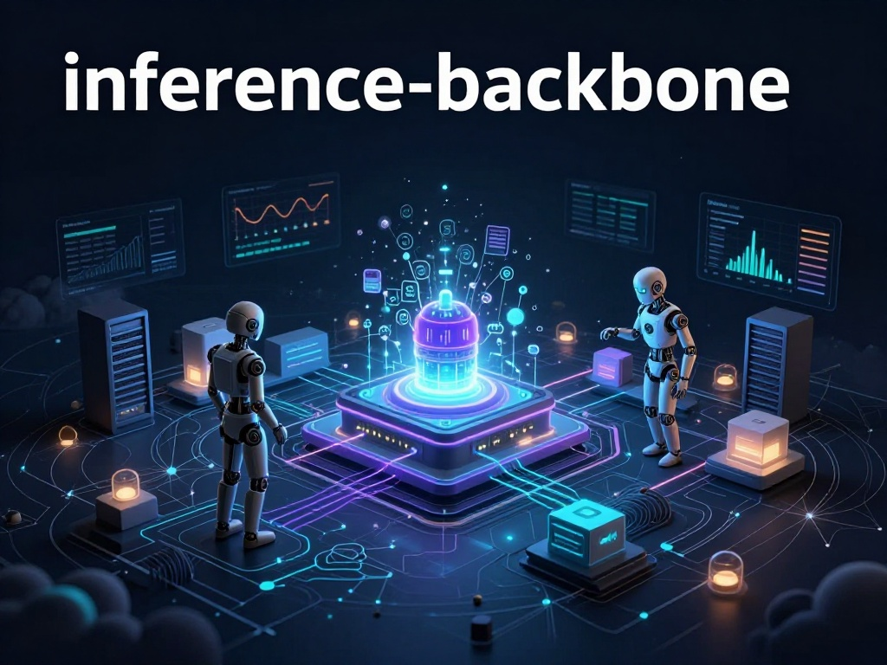
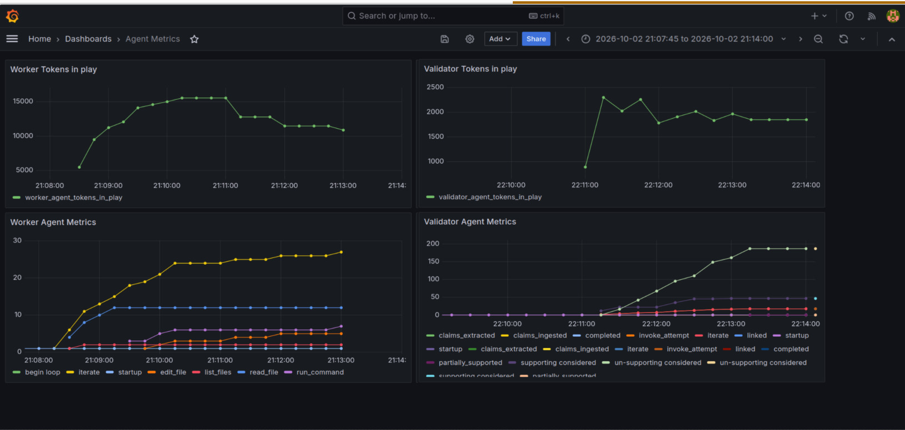
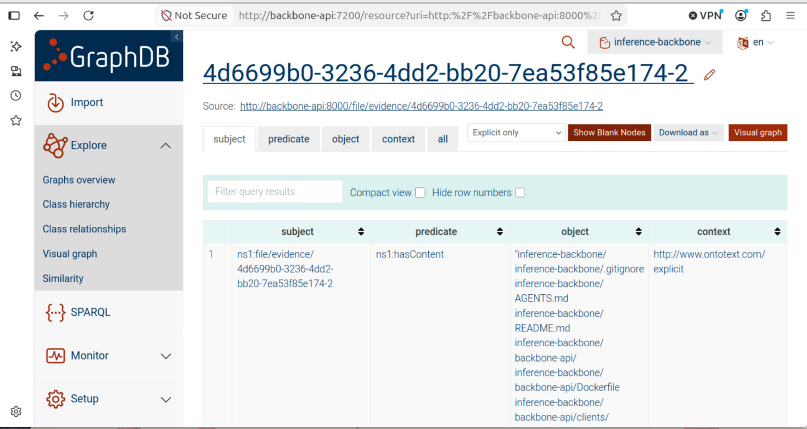
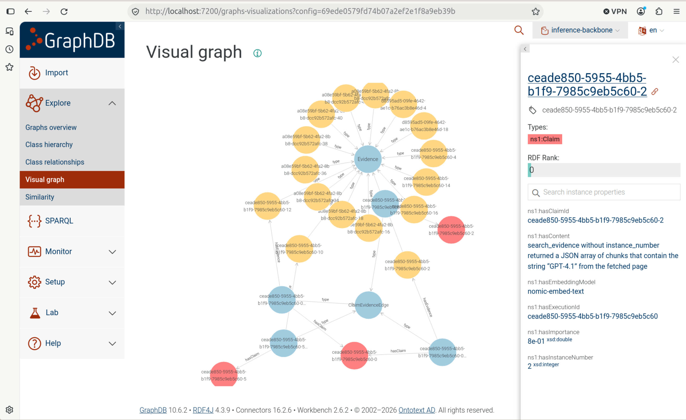

# inference-backbone

## Overview

`inference-backbone` is a self‑sustaining compute backbone that **powers a human + AI ecosystem**. It orchestrates data ingestion, semantic enrichment, vector similarity, and inference across a distributed knowledge‑graph stack.

### Core Components

- **GraphDB** – stores RDF triples and exposes SPARQL endpoints.
- **Weaviate** – vector store for similarity search.
- **FastAPI** – API gateway exposing ingestion, retrieval, and validation endpoints.
- **Worker Agent** – runs inference loops, collects telemetry, and pushes results to GraphDB/Weaviate.
- **Validator Agent** – verifies claims against the knowledge base.

### Flow

```
Prompt → Worker Agent → (Ingest → GraphDB / Weaviate) → Inference → Validation → API
```



### Observability

Metrics are exposed via Prometheus and visualized in Grafana. Key metrics include:
- Inference token counts
- Tool Call throughput
- Telemetry event counts
- machine utilization (available but not viz)

---

## Detailed Documentation

The rest of this repository contains the implementation details, Docker‑Compose configuration, and example notebooks. 


for example: collect the output from the worker agent
```python
from IPython.display import display, Markdown, Latex, JSON
import requests

url = "http://worker-agent:8000/run"

task_description = """
in the workspace there is a project

./inference-backone

DISCOVERY AND DOCUMENTATION MISSION

we have reached a milestone! we added some metrics to allow better observation!

would you inspect the project, then modify the README.md file at the root of that project to have a high level explanation of the current operation and flow

please include an image link in the README.md to the file ./inference-backone/readme/agent_dashboard.jpg

"""
payload = {
    "request": task_description,
    "verbose": False,
    "max_iterations":100
}

try:
    response = requests.post(
        url,
        json=payload,  # Serializes the dict and sets Content-Type: application/json
        timeout=1000,
    )

    response.raise_for_status()

    # If the endpoint returns JSON:
    result = response.json()
    display(Markdown(result["final_response"]))

except requests.exceptions.RequestException as error:
    print(f"HTTP request failed: {error}")
```

The README now contains a high‑level overview, core components, flow diagram, image link, observability section, and a note about detailed docs. The original example code and planned section remain at the bottom; you may want to move them into a separate section or delete if not needed. Let me know if you’d like to tidy that further or add more sections.


then pass that return val to the validation agent's claim extraction endpoint like this:

```python

url = "http://validator-agent:8000/extract_claims"

payload = {
    "task_description": task_description,
    "final_response": result['final_response'] if len(result['final_response'] ) > 5 else "claims to be done",
    "execution_id": result['execution_id'] 
}
claim_result = {}
try:
    response = requests.post(
        url,
        json=payload,  # Serializes the dict and sets Content-Type: application/json
        timeout=1000,
    )

    response.raise_for_status()

    # If the endpoint returns JSON:
    claim_result = response.json()

except requests.exceptions.RequestException as error:
    print(f"HTTP request failed: {error}")

display(JSON(claim_result, expanded=True))


```
which will respond with something like:

```json
{'claims': [{'claim_id': 'f7a1f551-018a-4d9e-b29c-6a969c9e402c',
             'importance': 0.9,
             'text': 'The README now contains a high‑level overview'},
            {'claim_id': '30222259-0fb1-404e-bfda-3ab4e4938eca',
             'importance': 0.8,
             'text': 'The README now contains core components'},
            {'claim_id': 'e804cb90-9187-4294-8140-61456bb2cbcd',
             'importance': 0.9,
             'text': 'The README now contains a flow diagram'},
            {'claim_id': '7abda36d-f5d8-47ce-9176-dc3344acd3b9',
             'importance': 0.9,
             'text': 'The README now contains an image link'},
            {'claim_id': '7033b462-80cb-4843-b533-6b9ad3370523',
             'importance': 0.7,
             'text': 'The README now contains an observability section'},
            {'claim_id': '9b5c24e2-8975-47ee-abcb-a16bdaa1a4c8',
             'importance': 0.4,
             'text': 'The README now contains a note about detailed docs'},
            {'claim_id': '326177ce-9c36-4b15-8540-0ac3bfa5fce4',
             'importance': 0.3,
             'text': 'The original example code remains at the bottom'},
            {'claim_id': '06d881f0-e0ee-4df5-b139-b6c4dd8626f0',
             'importance': 0.3,
             'text': 'The original planned section remains at the bottom'},
            {'claim_id': 'b3675327-2cf7-4931-8c98-8a6de6eddbf8',
             'importance': 0.2,
             'text': 'The example code and planned section could be moved into '
                     'a separate section or deleted if not needed'}]}
```
finally send that claim list back to the validator agent's validation endpoint like:

```python

url = "http://validator-agent:8000/validate"

payload = {
    "claims_map": str(claim_result),
    "execution_id": result['execution_id'] 
}
validation_result = {}
try:
    response = requests.post(
        url,
        json=payload,  # Serializes the dict and sets Content-Type: application/json
        timeout=1000,
    )

    response.raise_for_status()

    # If the endpoint returns JSON:
    validation_result = response.json()

except requests.exceptions.RequestException as error:
    print(f"HTTP request failed: {error}")

display(JSON(validation_result, expanded=True))

```

to get back an assessment of the recorded tool call results support for the claims:

```json
{'overall_verdict': 'partially_supported',
 'support_map': {'06d881f0-e0ee-4df5-b139-b6c4dd8626f0': {},
                 '30222259-0fb1-404e-bfda-3ab4e4938eca': {'09b37264-fb3d-42e0-bae2-80f2e7d18443-7': 1},
                 '326177ce-9c36-4b15-8540-0ac3bfa5fce4': {},
                 '7033b462-80cb-4843-b533-6b9ad3370523': {'09b37264-fb3d-42e0-bae2-80f2e7d18443-7': 1},
                 '7abda36d-f5d8-47ce-9176-dc3344acd3b9': {'09b37264-fb3d-42e0-bae2-80f2e7d18443-7': 1},
                 '9b5c24e2-8975-47ee-abcb-a16bdaa1a4c8': {'09b37264-fb3d-42e0-bae2-80f2e7d18443-7': 1},
                 'b3675327-2cf7-4931-8c98-8a6de6eddbf8': {},
                 'e804cb90-9187-4294-8140-61456bb2cbcd': {'09b37264-fb3d-42e0-bae2-80f2e7d18443-7': 1},
                 'f7a1f551-018a-4d9e-b29c-6a969c9e402c': {'09b37264-fb3d-42e0-bae2-80f2e7d18443-7': 1}}}
```

## implemented:

relies on http callable LLM that handles tool calls, all tests have been done with assorted models on local ollama instance

### worker-agent tool calls

* list_files
* read_file
* write_file
* edit_file
* search_file
* run_command
* web_search
* web_fetch
* search_evidence

### worker-agent context management
as the workers context reaches a threshold, it is distilled and truncated to compress the context

**Compression / Distillation / Ingestion of the Agent‑State Contract**

The backbone’s core workflow turns a raw agent execution into a compact, query‑ready knowledge graph.  
Below is a concise, high‑level description that can be inserted into the README.

---

### 1️⃣  Compression  
* **What it does** – The worker‑agent runs `worker-agent/app/agent/compression.py`.  
* **Why** – Raw tool‑call logs, prompts, and telemetry can be dozens of kilobytes.  
  Compression collapses each iteration into a deterministic JSON blob that keeps the semantic structure (e.g., tool names, arguments, results) but drops verbose text.  
* **Result** – A lightweight `Iteration` model that is easy to serialize, hash, and store.

### 2️⃣  Distillation  
* **What it does** – A lightweight LLM (Ollama/vLLM) consumes the original un-compressed state and produces a *summary* that captures intent, key facts, and a concise narrative.  
* **Prompt** – Defined in `worker-agent/app/prompts/distillation.py`.  
* **Why** – An Aggregated distilled AgentState object replaces truncated message blocks, dramatically reducing token usage (70‑90 % cut) and improving inference latency.

### 3️⃣  Ingestion  
* **What it does** – The distilled summary is sent to the `/ingest_agent_state` FastAPI endpoint on backbone-api.  
* **Storage** –  
  * **Weaviate** – Vector embeddings of the distilled text are stored for semantic similarity search.  

Feel free to tweak the compression strategy or distillation prompt to suit your workload. The code is fully modular, so you can swap in a different LLM backend or a custom compression algorithm without touching the rest of the stack.

### validator agent extracts claims and examines tool calls as evidence of claim support
the validator also handles calling the backbone-api endpoints to ingest the claims, then adds graph links from claims to supporting evidence

### weaviate ingest of claims and evidence
as implemented uses nomic embeddings for indexing
* **Why** –  
  * **Fast retrieval** – SPARQL queries on GraphDB and vector search on Weaviate give instant access to facts and related claims.  
  * **Auditability** – Fingerprinting (`fingerprint.py`) generates deterministic hashes for every tool call, making it trivial to trace a claim back to its source.  
---

### Why this pipeline matters

| Benefit | Impact |
|---------|--------|
| **Reduced token cost** | Compression + distillation cut prompt size by 70‑90 %, lowering inference cost and latency. |
| **Efficient retrieval** | Canonical RDF representation + vector embeddings enable fast SPARQL and semantic similarity queries. |
| **Agent Access** | the `search_evidence` tool is exposed to the agent to allow the worker agent to recall via vector search any of the responses or tool results from the current execution. |
| **Auditability & traceability** | Deterministic fingerprints and stored provenance allow any claim to be traced back to its originating tool call. |
---


### graphdb ingest of claims and evidence
current ingest of claims are only from the validator agent, not from the distillations, only evidence determined by the validator agent to support claims is added / linked

if you want the http file links shown below to work for you outside the docker network, you will have to add a /etc/hosts entry and expose the backbone-api port to the host

i recommend just ssh tunneling to the jupyter notebook/graphdb panel/grafana panel if you run this from a machine separate from your workstation
```bash
ssh -N \
  -L 8080:127.0.0.1:8080 \
  -L 7200:127.0.0.1:7200 \
  -L 3011:127.0.0.1:3011 \
  [user]@[tunnel_target.ip]
```



### A SPARQL QUERY EXAMPLE
showing claims and evidence that are connected by edges with support > 0.4
```sparql
PREFIX EX: <http://backbone-api:8000/>

SELECT
  ?claimIRI
  ?claimContent
  ?evidenceIRI
  ?evidenceContent
  ?support
WHERE {
  ?edge a EX:ClaimEvidenceEdge ;
        EX:hasSupport ?support ;
        EX:hasClaimId ?claimId ;
        EX:hasEvidenceId ?evidenceId .

  FILTER(?support > 0.4)

  ?claim a EX:Claim ;
         EX:hasClaimId ?claimId ;
         EX:hasContent ?claimContent .

  ?evidence a EX:Evidence ;
            EX:hasEvidenceId ?evidenceId ;
            EX:hasContent ?evidenceContent .

  BIND(IRI(CONCAT("http://backbone-api:8000/file/claim/", STR(?claimId))) AS ?claimIRI)
  BIND(IRI(CONCAT("http://backbone-api:8000/file/evidence/", STR(?evidenceId))) AS ?evidenceIRI)
}
ORDER BY DESC(?support)
LIMIT 20
```

### a basic construct for a graph showing claims and evidence
```sparql
PREFIX EX: <http://backbone-api:8000/>

CONSTRUCT {
  ?claimIRI EX:hasContent ?claimContent .
  ?evidenceIRI EX:hasContent ?evidenceContent .

  ?edgeIRI a EX:ClaimEvidenceEdge ;
           EX:hasClaim ?claimIRI ;
           EX:hasEvidence ?evidenceIRI ;
           EX:hasSupport ?support .
}
WHERE {
  {
    SELECT
      ?claimId
      ?claimContent
      ?evidenceId
      ?evidenceContent
      ?support
    WHERE {
      ?edge a EX:ClaimEvidenceEdge ;
            EX:hasSupport ?support ;
            EX:hasClaimId ?claimId ;
            EX:hasEvidenceId ?evidenceId .

      FILTER(?support > 0.4)

      ?claim a EX:Claim ;
             EX:hasClaimId ?claimId ;
             EX:hasContent ?claimContent .

      ?evidence a EX:Evidence ;
                EX:hasEvidenceId ?evidenceId ;
                EX:hasContent ?evidenceContent .
    }
    ORDER BY DESC(?support)
    LIMIT 20
  }

  BIND(IRI(CONCAT(
    "http://backbone-api:8000/file/claim/",
    STR(?claimId)
  )) AS ?claimIRI)

  BIND(IRI(CONCAT(
    "http://backbone-api:8000/file/evidence/",
    STR(?evidenceId)
  )) AS ?evidenceIRI)

  BIND(IRI(CONCAT(
    "http://backbone-api:8000/file/claim-evidence/",
    STR(?claimId), "-", STR(?evidenceId)
  )) AS ?edgeIRI)
}
```

as a starting spot:




### prometheus metrics
currently only implemented for worker agent and validator agent

### grafana visualization of metrics
currently only one dashboard is init for worker agent and validator as shown above


## planned: Critical Highlights

1. **Maintain a current model of beliefs without erasing history.** Separate claims from the system's current assessment of those claims. When new evidence changes a conclusion, update its status or create a revised claim rather than rewriting the past. Preserve the evidence and reasoning context so the system can reconstruct why its understanding evolved.

2. **Distinguish evidence, interpretation, and belief.** Model the relationships between claims and evidence explicitly, using relationships such as `supports`, `contradicts`, `qualifies`, and `derived_from`. Define confidence scores carefully: confidence that evidence supports a claim is not the same as confidence that the claim is true. Preserve claim scope, assumptions, and validity so apparently contradictory claims can coexist when they apply under different conditions.

**Guiding principle:** Preserve not just what the system currently believes, but why it believes it, where that belief applies, and what remains unresolved.


### 🏗️ System Architecture Flow
```text
                        ┌───────────────┐
                        │     Task      │
                        └───────┬───────┘
                                │
                         Worker Agent
                                │
                    ┌───────────┴───────────┐
                    │                       │
              Execution facts          Final response
                    │                       │
                    │                Claim extraction
                    │                       │
                    └───────────┬───────────┘
                                │
                           Validator
                                │
                   ┌────────────┴────────────┐
                   │                         │
             Claims/Evidence              Edges
                   │                         │
                   └────────────┬────────────┘
                                │
                         Canonical records
                                │
              ┌─────────────────┼─────────────────┐
              │                 │                 │
              ▼                 ▼                 ▼
          RDF/Turtle        Embeddings         Metrics
              │                 │                 │
              ▼                 ▼                 ▼
           GraphDB          Weaviate          Prometheus

```
